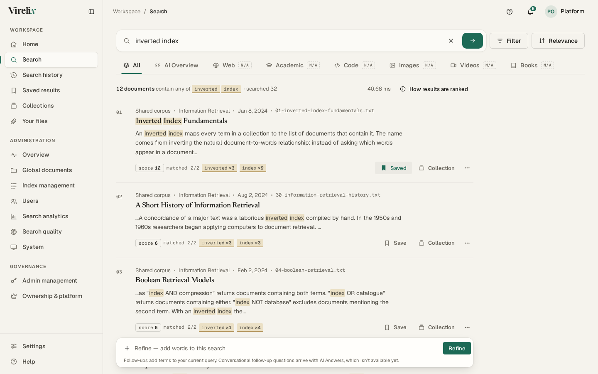
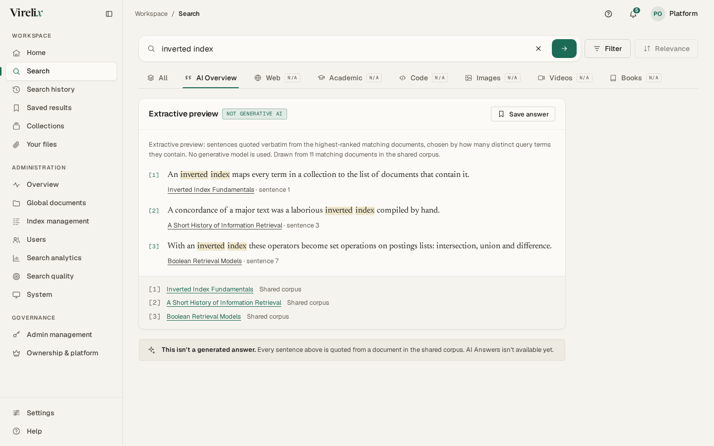
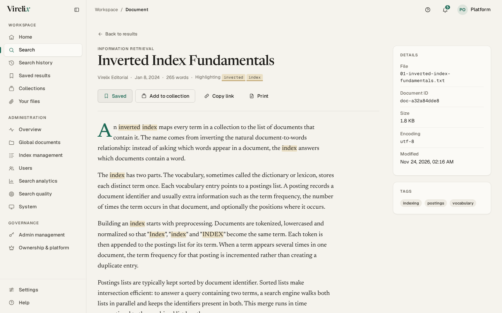
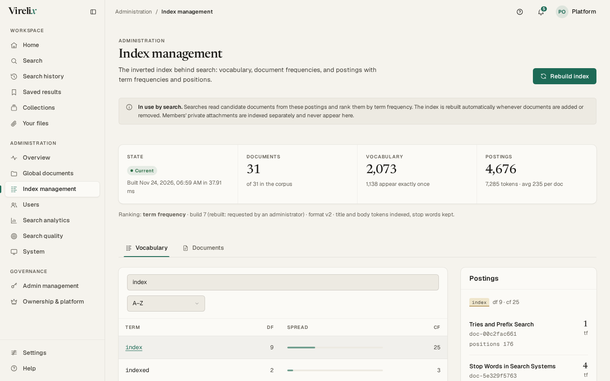
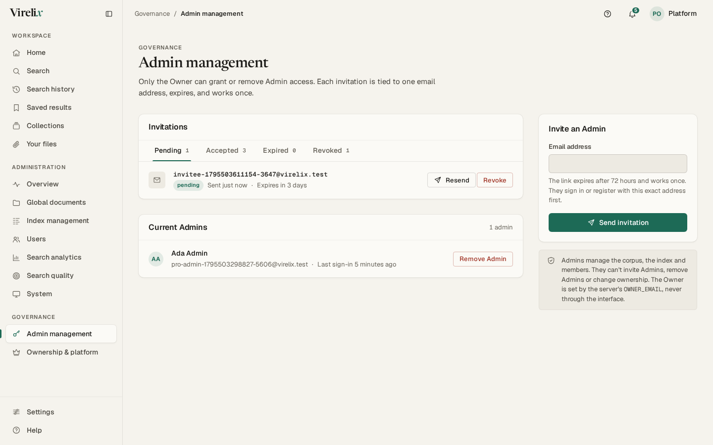
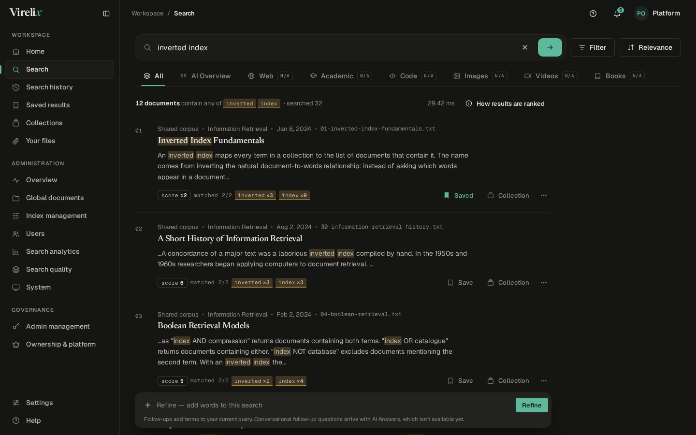

# Virelix

**Search and research across a shared document collection and your private files.**



## Overview

Teams that work from a body of documents (course notes, technical articles, reports) need to find
which documents discuss a topic, see **where and why** each one matched, and keep what they find.
Web search can't see a private collection, and opaque relevance scores are hard to trust or debug.

Virelix pairs a search engine built from first principles (document loading, text preprocessing
and an inverted index) with a complete product around it: accounts with three roles, a private
workspace for every user, and administration of the shared corpus. It runs on the Python standard
library and a vanilla HTML/CSS/JavaScript front end, with no packages and no build step.

> **Search is ranked by term frequency.** A document's score is the number of times the query's words
> occur in it, read from the inverted index. Each result shows its score, the count for every word and
> a highlighted passage. A score is a count, never a percentage.

## Features

| Area | What works today |
|---|---|
| Search | Inverted-index retrieval ranked by term frequency (any term by default, all terms, exact phrase); score and per-term counts on every result; highlighted snippets; floating filters (source, matching mode, subject); relevance, title and date sorting over the full result set; pagination; response time; follow-up refinement |
| AI Overview | Extractive: sentences quoted verbatim from the highest-ranked matching documents with numbered references; can be saved. Not generative |
| Documents | Reader with highlighting, metadata, save and add-to-collection |
| Workspace | Search history, saved results and previews, collections, private `.txt` attachments (24 h) searched through a private per-user index, in-app notifications |
| Accounts | Registration, email verification, sign-in with throttling, remember me, password reset and change, session management |
| Administration | Corpus overview, global documents (upload, preview, bulk removal), inverted-index status, inspection and rebuild, user suspension, system status |
| Governance | Admin invitations (email-bound, expiring, single use), Admin removal, audit log, ownership status |
| Appearance | Light (default), dark, OLED and system themes; six accents; text size, density, sidebar and motion preferences; responsive from 320 px |

**Not available yet**, and labelled as such in the app: AI Answers, Research Mode,
voice search, web/academic/code/media sources, search analytics, search-quality metrics and email delivery.

## Technology

| Layer | Technology |
|---|---|
| Backend | Python 3.11+ standard library (`http.server`, `hashlib.scrypt`, `json`, `threading`) |
| Storage | JSON files with atomic writes and per-store locks; the sample corpus as `.txt` files |
| Search engine | Custom loader, preprocessing pipeline and inverted index (`dict[term, dict[doc_id, Posting]]`) |
| Frontend | HTML5, CSS3, Bootstrap 5.3 (vendored), vanilla JavaScript ES modules, no bundler |
| Testing | `unittest` (backend), Playwright and axe-core (browser, development only) |

## Architecture

```
Browser (single-page app: router · API client with CSRF · views · Bootstrap components)
   │  JSON over same-origin HTTP · raw-text uploads
   ▼
backend/server.py   HTTP server, security headers, static allow-list, data-folder lock
backend/app.py      route table · session resolution · CSRF and role checks · handlers
   ├── services/auth.py        accounts, sessions, verification, reset, Owner designation
   ├── services/governance.py  Admin invitations, Admin removal, suspension
   ├── services/workspace.py   history, saved items, collections, attachments, preferences
   └── services/corpus.py      shared corpus and index lifecycle
backend/search/     loader.py · preprocess.py · index.py · engine.py · overview.py
backend/storage.py  atomic JSON stores in data/   ·   corpus/ sample documents
```

Details: [docs/architecture.md](docs/architecture.md) · [docs/api.md](docs/api.md)

## Getting started

Requirements: **Python 3.11 or newer**. Nothing to install, and no WSL, Docker or Node.js is needed to run Virelix.

**Windows** (PowerShell or Command Prompt)

```powershell
git clone https://github.com/jiteshgulati/Virelix.git
cd Virelix
copy .env.example .env     # then edit .env: set OWNER_EMAIL to the address that should own this installation
py run.py                  # or: python run.py   →  http://localhost:8000
```

**Linux and macOS**

```bash
git clone https://github.com/jiteshgulati/Virelix.git
cd Virelix
cp .env.example .env      # then edit .env: set OWNER_EMAIL
python3 run.py            # →  http://localhost:8000
```

`py run.py --host 127.0.0.1 --port 9000` (or `python3 run.py …`) overrides the address. The console shows the URL,
corpus status, Owner status and, in development mode, where verification links appear.

### Configuration (`.env`)

| Variable | Default | Purpose |
|---|---|---|
| `OWNER_EMAIL` | unset | The single designated Owner of this installation |
| `VIRELIX_ENV` | `development` | `production` disables the developer mailbox |
| `VIRELIX_HOST` / `VIRELIX_PORT` | `127.0.0.1` / `8000` | Bind address. Keep loopback unless you mean to share it |
| `VIRELIX_SECURE_COOKIES` | `0` | Set to `1` behind HTTPS |
| `VIRELIX_DATA_DIR` / `VIRELIX_CORPUS_DIR` | `data/`, `corpus/` | Storage locations |
| `VIRELIX_DEV_MAILBOX_KEY` | random per start | Key for the developer mailbox page |
| `VIRELIX_SECRET_KEY` | unset | Reserved; nothing is signed with it yet |

Real environment variables take precedence over `.env`. Both `.env` and `data/` are git-ignored and
never leave your machine. Only one server may use a data folder at a time.

### Accounts and roles

1. Register with the address in `OWNER_EMAIL`. No email is delivered in development; the verification link is printed in the server console.
2. After verifying and signing in you are the **Owner**. Invite teammates as **Admins** from *Governance → Admin management*.
3. Everyone else who registers is a **Member**.

| | Member | Admin | Owner |
|---|:-:|:-:|:-:|
| Search, documents, own workspace and settings | ✅ | ✅ | ✅ |
| Administration: corpus, index, users, system | ⛔ | ✅ | ✅ |
| Governance: Admin invitations and removal, audit log | ⛔ | ⛔ | ✅ |
| Another person's private data | ⛔ | ⛔ | ⛔ |

One shared installation has exactly one Owner; ownership never transfers automatically. See
[docs/roles-and-onboarding.md](docs/roles-and-onboarding.md).

## How search works

1. **Loading.** `.txt` files in `corpus/` are discovered and decoded (UTF-8 with fallbacks), given stable IDs (`doc-` + hash of the filename) and parsed for an optional `Key: value` metadata header.
2. **Preprocessing.** NFKC normalisation, case folding, apostrophe joining, punctuation to spaces, whitespace collapse, tokenisation. The same pipeline is applied to queries.
3. **Index.** An inverted index of terms → postings (document, term frequency, positions), with vocabulary statistics. It's loaded and validated at start-up, rebuilt automatically when it's missing, damaged or out of date and whenever documents are added or removed, and can be inspected and rebuilt in *Index management*. Each member's attachments get their own private index.
4. **Retrieval.** Only the posting lists of the query's words are read: their union for *Any term*, their intersection for *All terms*, and the intersection plus a position check for *Exact phrase*.
5. **Ranking.** `Score(d, q) = Σ tf(t, d)` over the query's distinct words, so a document mentioning "python" three times and "programming" twice scores 5 for `python programming`. Repeating a query word doesn't change any score. Equal scores are ordered by title, then document ID. Sorting and filters apply to the full result set before pagination.
6. **Snippets.** For each result on the page, the 160–240 character passage containing the most distinct query words is shown, cut at sentence or word boundaries with the words highlighted. When the words only occur in the title, the document's opening is shown instead.

## Screenshots

| | |
|---|---|
|  Ranked results |  Extractive overview |
|  Document viewer |  Index management |
|  Admin management |  Dark theme |

All screenshots are in [docs/screenshots/](docs/screenshots/) and are generated from synthetic accounts with `npx playwright test screenshots`.

## Tests

```bash
python3 -m unittest discover -s tests/backend -t .     # backend (Windows: py -m unittest discover -s tests/backend -t .)
cd tests/e2e && npm ci && npx playwright install chromium
npx playwright test                                    # browser; isolated server on port 8799
python3 scripts/smoke_test.py                          # start-up smoke test (from the project root)
```

Browser tests run their own server with a copied corpus, temporary data and synthetic accounts.
Node.js and Playwright are development tools only. Latest verified results: [docs/test-results.md](docs/test-results.md).

### Platform support

| Platform | Status |
|---|---|
| Windows (native Python 3.14) | Backend suite and start-up smoke test (server, sign-in, ranked search, second-instance refusal) pass on a real Windows install. The browser suite hasn't been run on Windows |
| Linux (Python 3.14, WSL2 Ubuntu) | Backend and browser suites run |
| macOS | Backend suite passes in GitHub Actions (`macos-latest`). Not tested interactively |
| CI | `.github/workflows/ci.yml` runs the backend suite and smoke test on Ubuntu (Python 3.11 and 3.13), Windows and macOS, and the browser suite on Ubuntu, for every pull request and every push to `master`. Results are recorded in [docs/test-results.md](docs/test-results.md) |

## Project structure

```
run.py                    entry point
backend/                  server, routing, security, storage, services, search engine
frontend/                 index.html, CSS, ES-module JavaScript, vendored Bootstrap and fonts
corpus/                   31 sample .txt documents + inventory.json
data/                     runtime data (git-ignored)
analysis/                 reserved for query analysis
scripts/                  corpus_inventory.py · owner_recovery.py · smoke_test.py
tests/backend/  tests/e2e/
docs/                     architecture, API, roles, design system, team, test results, screenshots
```

## Development workflow

Work happens on short-lived branches (`feature/…`, `fix/…`, `docs/…`) merged into `master` through
reviewed pull requests, with Conventional Commit messages. Setup, conventions, testing and security
rules are in [CONTRIBUTING.md](CONTRIBUTING.md). Module ownership is in
[docs/team-responsibilities.md](docs/team-responsibilities.md).

## Team

**Jitesh Gulati**: Full-Stack Developer, Search Engine & Platform Engineering. GitHub: [@jiteshgulati](https://github.com/jiteshgulati)

**Chaitain Gupta**: Full-Stack Developer, Interface & Data Engineering. GitHub: [@chaitanya-gupta-07](https://github.com/chaitanya-gupta-07) (Chaitanya on GitHub)

The foundation was built by both developers working together on a shared computer. Each component
commit names its area lead as author and the other developer as co-author. Both developers share
requirements, integration, code review, testing, documentation and delivery.
See [docs/team-responsibilities.md](docs/team-responsibilities.md) for the full division of work.

## Security

scrypt password hashing; random 256-bit session tokens stored only as hashes; HttpOnly,
SameSite=Strict cookies; CSRF double-submit plus Origin checks; login and password-change
throttling; a strict Content-Security-Policy; an allow-list for static files; per-account isolation of
workspace data; a privileged-action audit log; and a developer mailbox restricted to development
mode, loopback connections and a console-printed key.

## Licence

No licence has been chosen for Virelix yet, so all rights are reserved by the authors. Bundled
third-party components keep their own licences. See [THIRD_PARTY_NOTICES.md](THIRD_PARTY_NOTICES.md).

---

## Academic project

Virelix is developed as **PST_AD_164: Search Engine Backend (Mini Elasticsearch)** by Team **G393**
(Jitesh Gulati and Chaitain Gupta) over four weekly milestones: foundation; ranked retrieval;
query analytics; evaluation and delivery. Academic planning stays separate from the product:

- [Week 1 acceptance checklist](docs/week1-checklist.md)
- [Limitations and Week 2 handoff](docs/week2-handoff.md) (the Week 1 plan for Week 2)
- [Week 2 acceptance checklist](docs/week2-checklist.md)
- [Week 3 handoff](docs/week3-handoff.md)
- [Analysis plan](analysis/README.md)
- [Team responsibilities by milestone](docs/team-responsibilities.md)

**Development assistance.** AI-based coding assistance was used during development of this project.
The team reviews, tests and is responsible for everything in the repository. Add or adjust this
statement to match your institution's disclosure requirements before submission.
